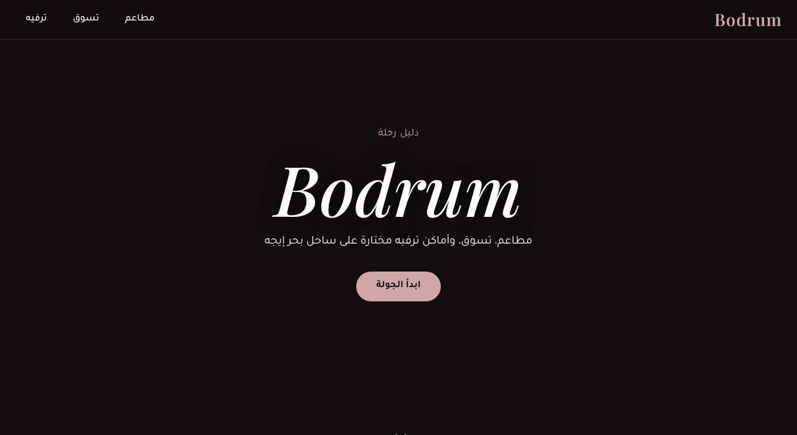
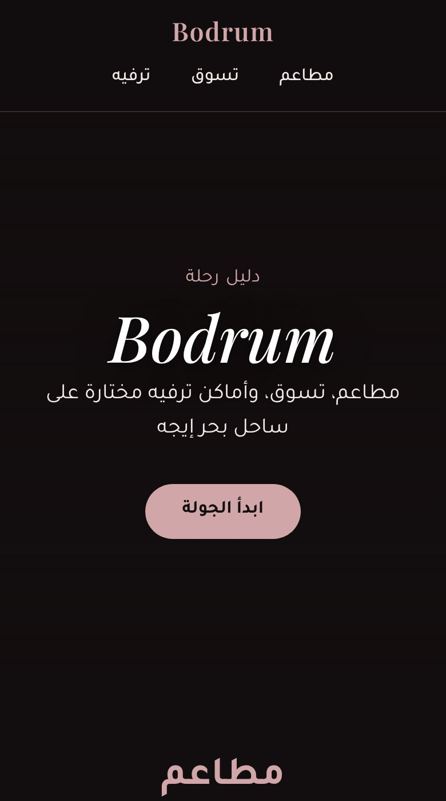

# Bodrum Travel Guide

**Live site:** https://irbala.github.io/Bodrum

  
  

Click a screenshot to open the live site.

An Arabic (right-to-left) one-page guide to Bodrum, Turkey: restaurants and cafes, shopping, and places to visit on the Aegean coast. Each place is a photo card that opens its Instagram page.

## Sections

- **مطاعم**: places to eat and drink coffee
- **تسوق**: shops and markets
- **ترفيه**: marinas, old town and places to spend the day

## How it's built

- HTML and CSS only, with no JavaScript
- One stylesheet (`style.css`) with the colours and fonts set as variables
- A full-width hero photo and a responsive grid of place cards
- Fonts: Tajawal for Arabic and Playfair Display for the title

## Design Decisions

- **Evening palette.** A near-black background with dusty rose and wine accents gives the guide the feel of a Bodrum evening by the sea. <!-- guess: Fay, please confirm or edit -->
- **Two typefaces, two scripts.** Playfair Display in italic for the Latin "Bodrum" title adds a touch of elegance, and Tajawal handles all the Arabic text.
- **One page, three sections.** Restaurants, shopping and things to do sit on one page with a sticky menu that jumps to each, so there is nothing to load while browsing.
- **Photo cards that open Instagram.** Each place is a photo card linking to its Instagram, where places post their latest photos and menus. <!-- guess: Fay, please confirm or edit -->
- **Right-to-left grid.** The page is `lang="ar" dir="rtl"`, so the card grid fills from the right like Arabic text.

## Accessibility

Checked on 19 November 2026 with [axe-core](https://github.com/dequelabs/axe-core) 4.10, the engine behind Lighthouse's accessibility score, against WCAG 2.1 A and AA plus axe's best-practice rules. Every page was tested in a desktop browser.

| Page | Issues | Rules passed |
|---|---|---|
| `index.html` | ✅ 0 issues | 26 |

Note: place photos are loaded from other websites, so a few may stop loading if those sites change.

Fixed in this round:

- Place photos now have empty alt text because each card already shows the place name. Screen readers were reading every name twice (axe rule `image-redundant-alt`).

## Run it locally

Download or clone the repo and open `index.html` in a browser.
